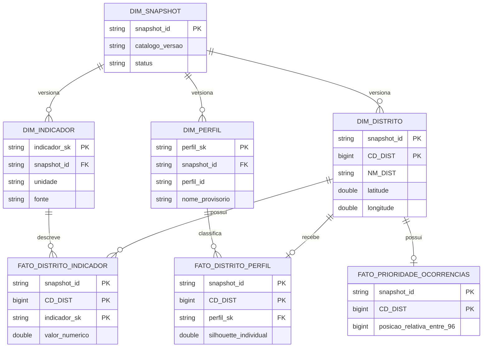

## Modelagem dimensional — Star Schema

Para transformar os indicadores territoriais em análises comparáveis e rastreáveis, o BairroIQ conta com um **modelo dimensional materializado em Delta Lake**, composto por **quatro dimensões e três tabelas de fatos**.

A estrutura funciona como uma *constelação de fatos*: distritos, indicadores, perfis e snapshots são referências compartilhadas pelas análises.

### Estrutura e relacionamentos



### Estrutura física no Databricks

As sete tabelas foram materializadas em **Delta Lake**, no catálogo e schema `workspace.gold`, utilizando o prefixo `bairroiq_`.

| Tabela | Finalidade | Registros |
|---|---|---:|
| `bairroiq_dim_snapshot` | Identificação, versionamento e estado do snapshot | 1 |
| `bairroiq_dim_distrito` | Cadastro oficial e coordenadas geográficas | 96 |
| `bairroiq_dim_perfil` | Catálogo de perfis territoriais exploratórios | 9 |
| `bairroiq_dim_indicador` | Metadados, fontes e unidades dos indicadores | 11 |
| `bairroiq_fato_distrito_indicador` | Indicadores quantitativos por distrito | 1.056 |
| `bairroiq_fato_distrito_perfil` | Associação dos distritos aos perfis territoriais | 96 |
| `bairroiq_fato_prioridade_ocorrencias` | Ordenação relativa de roubos e furtos | 96 |
| **Total** | **7 tabelas Delta** | **1.365** |

### Governança e integridade

A modelagem foi desenvolvida para garantir rastreabilidade dos dados, consistência dos relacionamentos e evolução controlada das informações.

- **Chaves oficiais:** relacionamento distrital por `snapshot_id` e `CD_DIST`.
- **Integridade referencial:** verificações das associações entre dimensões e fatos.
- **Versionamento:** snapshots identificados por versão do catálogo e hash SHA256 da fonte.
- **Imutabilidade:** materialização append-only, sem sobrescrita dos snapshots anteriores.
- **Consistência:** conferência de schema, cardinalidade, chaves e conteúdo.
- **Publicação controlada:** dados internos, sem disponibilização pública automática.

A dimensão `bairroiq_dim_snapshot` é registrada por último na materialização, funcionando como marcador de conclusão. As sete tabelas não constituem uma transação única.

### Exemplo de consulta

A consulta abaixo combina distritos e indicadores, preservando as chaves e o snapshot de referência.

```sql
SELECT
    d.NM_DIST AS distrito,
    i.rotulo AS indicador,
    f.valor_numerico,
    i.unidade,
    i.periodo_referencia_documentado
FROM workspace.gold.bairroiq_fato_distrito_indicador AS f

INNER JOIN workspace.gold.bairroiq_dim_distrito AS d
    ON f.snapshot_id = d.snapshot_id
    AND f.CD_DIST = d.CD_DIST

INNER JOIN workspace.gold.bairroiq_dim_indicador AS i
    ON f.snapshot_id = i.snapshot_id
    AND f.indicador_sk = i.indicador_sk

WHERE f.snapshot_id = 'v3.0.0-candidato|726091fefefa868fd5d0d2c6929b1d68c4849941f4c7510b4fee0d93a075d38b'

ORDER BY distrito, indicador;
```

**Resultado esperado:** 1.056 registros, correspondentes a 96 distritos e 11 indicadores por distrito.

### Integração com a camada de consumo

O Star Schema é a base da tabela de consumo destinada à futura aplicação web:

`workspace.gold.bairroiq_frontend_v1`

Essa tabela apresenta os indicadores de maneira simplificada, com **96 distritos, 13 campos técnicos e seis informações de exibição**:

**Distrito | Empregos | Roubos | Segurança | Mobilidade | Cluster**

O snapshot físico foi materializado e auditado em 05/11/2026, com integridade de conteúdo confirmada por SHA256. Os dados permanecem disponíveis apenas para uso interno, aguardando homologação e revisão de acesso antes de eventual publicação.

A documentação técnica está disponível no [Contrato do Star Schema Delta V1](docs/modelagem/star_schema_v1_delta_contrato.md).
