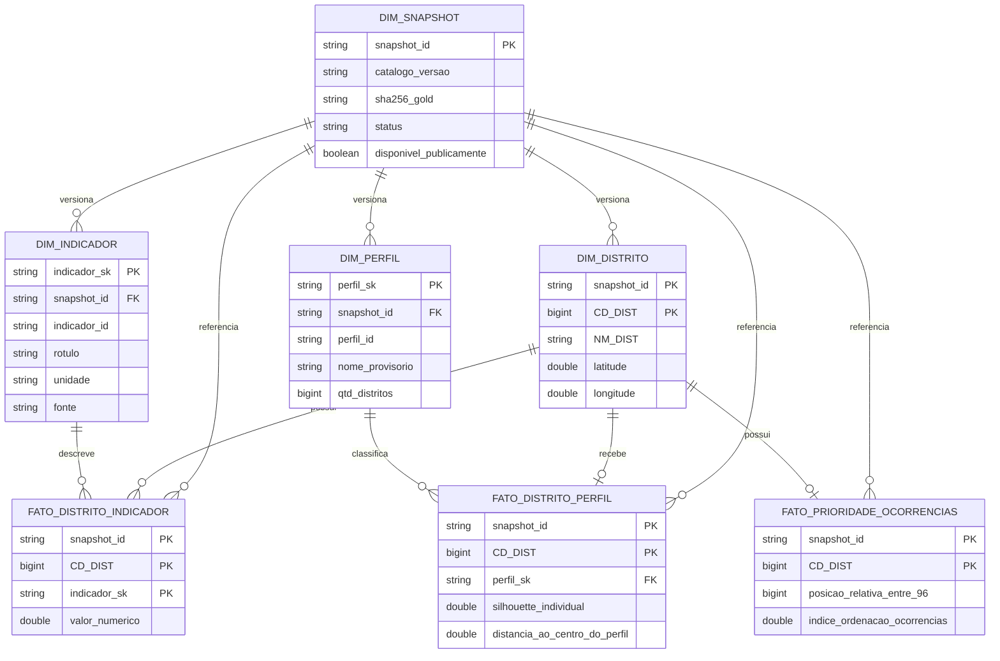

# BairroIQ — Inteligência Territorial para Decisões Mais Inteligentes

**Plataforma de inteligência geográfica e análise de dados urbanos para São Paulo.**

O BairroIQ é um projeto de Engenharia de Dados, Analytics e DataOps que integra informações públicas e imobiliárias para construir uma visão multidimensional das regiões de São Paulo.

Seu objetivo é transformar dados fragmentados em informações confiáveis, comparáveis e explicáveis, apoiando decisões sobre **onde morar, investir ou estabelecer um negócio**.

O projeto utiliza uma arquitetura de dados em nuvem, pipelines de processamento distribuído, governança e automação de qualidade.

**Status atual (novembro de 2026):** infraestrutura, base analítica, modelos exploratórios de perfis territoriais, modelagem dimensional e camada física de consumo implementados e validados internamente. A aplicação web e as recomendações ao usuário estão em desenvolvimento; **não há publicação pública nem perfis homologados para recomendações residenciais**.

---

## Principais entregas

O BairroIQ já possui uma base analítica georreferenciada, **materializada e validada internamente no Databricks**, consolidando informações demográficas, socioeconômicas, urbanas, criminais e imobiliárias.

O projeto evoluiu também para a identificação de perfis territoriais e para uma estrutura de dados preparada para a futura experiência web.

| Indicador | Resultado |
|---|---:|
| Distritos administrativos de São Paulo | **96** |
| Atributos disponíveis na base analítica | **254** |
| Indicadores socioeconômicos integrados | **104** |
| Categorias de ocorrências criminais | **41** |
| Indicadores de equipamentos urbanos | **42** |
| Indicadores de infraestrutura normalizados | **42** |
| Distritos com coordenadas geográficas | **96 (100%)** |
| Registros na base imobiliária mensal | **29.612** |
| Localidades imobiliárias identificadas | **1.626** |
| Jobs configurados no Databricks Bundle | **7** |
| Perfis territoriais exploratórios | **9** |
| Tabelas do modelo dimensional Delta | **7** |
| Distritos no consumidor físico do frontend | **96 (100%)** |

### O que foi construído

- **Data Lakehouse:** arquitetura Medallion com camadas Bronze, Silver e Gold utilizando Databricks, Apache Spark e Delta Lake.
- **Integração multifuente:** consolidação de dados do IBGE, GeoSampa, ObservaSampa, SSP-SP e referências do mercado imobiliário.
- **Base analítica geográfica:** tabela com 254 atributos para os 96 distritos oficiais do município.
- **Georreferenciamento:** cálculo de centroides geográficos a partir da malha distrital oficial do IBGE 2022.
- **Associação territorial:** processo de correspondência entre bairros imobiliários e distritos administrativos, utilizando OpenStreetMap e validação dos vínculos.
- **Data Quality:** testes automatizados de integridade, consistência, granularidade, cobertura e conformidade dos dados.
- **DataOps e CI/CD:** pipelines de integração contínua, validação de Databricks Asset Bundles e deploy controlado.
- **Governança:** contratos de dados, documentação das 254 colunas, comentários no Unity Catalog, rastreabilidade e versionamento Delta.
- **Machine Learning:** comparação de K-Means e agrupamento hierárquico Ward para identificar perfis exploratórios dos 96 distritos; nove perfis selecionados para análise, sem classificação de melhor ou pior região.
- **Modelagem dimensional:** sete tabelas Delta com dimensões e fatos para distritos, perfis, indicadores e prioridades de ocorrências.
- **Camada de consumo:** tabela `workspace.gold.bairroiq_frontend_v1`, materializada com 96 registros, 13 campos físicos e seis informações previstas para a interface.
- **Auditoria do produto de dados:** conferência do schema, chaves, integridade SHA256, faixas das métricas e controle de publicação.

---

## Arquitetura da solução

O projeto utiliza a arquitetura **Medallion**, organizando o processamento em três camadas e conectando a Gold a componentes de modelagem, inteligência territorial e consumo.

```text
                   FONTES DE DADOS
                          |
          +---------------+---------------+
          |               |               |
        IBGE          GeoSampa        SSP-SP
          |               |               |
     ObservaSampa    Mercado Imobiliário
          |               |
          +-------+-------+
                  |
                  v
          BRONZE | Raw Data
       Dados originais preservados
                  |
                  v
          SILVER | Trusted Data
      Limpeza, tipagem, padronização
       e enriquecimento territorial
                  |
                  v
          GOLD | Analytics
       96 distritos oficiais
          254 atributos
       Coordenadas geográficas
                  |
          +-------+-------+
          |               |
          v               v
     MACHINE LEARNING   STAR SCHEMA
       9 perfis        4 dimensões
     exploratórios       3 fatos
          |               |
          +-------+-------+
                  |
                  v
       CONSUMER DELTA V1
       96 distritos auditados
      6 colunas de exibição
                  |
                  v
       APLICAÇÃO WEB (futura)
        Mapas e comparativos
       Exploração de perfis
      Preferências do usuário
```

### Camadas de dados

| Camada | Responsabilidade | Implementação |
|---|---|---|
| Bronze | Ingestão e preservação dos dados originais | Delta Lake e volumes gerenciados |
| Silver | Tratamento, validação e enriquecimento | PySpark, SQL e processamento geoespacial |
| Gold | Consolidação dos indicadores por distrito | Wide Table com 254 colunas |
| Modelagem | Organização de dimensões e fatos | 7 tabelas Delta materializadas |
| Inteligência territorial | Segmentação exploratória por perfis | K-Means K=9, com comparação a Ward |
| Consumo | Dados preparados para visualização | `bairroiq_frontend_v1` (Delta, interno) |
| Aplicação web | Mapas, filtros e comparação | Em desenvolvimento |

O processamento foi desenvolvido no Databricks, com governança pelo Unity Catalog.

---

## Fontes de informação

| Fonte | Dados utilizados | Aplicação |
|---|---|---|
| **IBGE** | População, domicílios, características demográficas e malha distrital | Perfil populacional e referência territorial |
| **GeoSampa** | Equipamentos públicos e infraestrutura urbana | Disponibilidade de serviços por distrito |
| **ObservaSampa** | Indicadores sociais, econômicos, educacionais e urbanos | Condições socioeconômicas |
| **SSP-SP** | Registros de ocorrências criminais | Indicadores de segurança pública |
| **Mercado imobiliário** | Anúncios, preços por metro quadrado e modalidades de transação | Análise de oferta e preços de imóveis |
| **OpenStreetMap** | Referências geográficas de localidades | Apoio à associação entre bairros e distritos |

Os indicadores preservam as unidades e os períodos de referência identificados em suas fontes.

**Não possuem todos uma mesma data de observação.** Os períodos ainda não confirmados são tratados como pendências de documentação, nunca inferidos pela data da execução.

### Integração territorial

Uma das dificuldades técnicas do projeto é a diferença entre os bairros utilizados pelo mercado imobiliário e os distritos administrativos oficiais.

Para tratar essa incompatibilidade, foi implementado um processo de associação territorial com validação e homologação de correspondências.

Na última validação documentada da cobertura imobiliária:

| Métrica | Resultado |
|---|---:|
| Localidades imobiliárias inventariadas | 1.626 |
| Bairros com associação aprovada | 93 |
| Estoque imobiliário total da fonte | 70.706 |
| Estoque associado a distritos | 28.085 |
| Cobertura do estoque | 39,72% |

A cobertura é apresentada explicitamente para evitar interpretações incorretas. Os imóveis sem associação territorial aprovada não são distribuídos arbitrariamente entre distritos.

---

## Base analítica e georreferenciamento

O principal produto de dados é a tabela:

`workspace.gold.distritos_wide`

Ela consolida os indicadores disponíveis em uma estrutura com **uma linha por distrito administrativo**.

A tabela inclui informações de população, domicílios, infraestrutura, indicadores socioeconômicos, segurança pública, mercado imobiliário e localização geográfica.

### Coordenadas oficiais

Todos os 96 distritos possuem coordenadas de latitude e longitude obtidas a partir de centroides calculados sobre a malha oficial do IBGE 2022.

O processamento utiliza uma projeção métrica (EPSG:31983) para o cálculo dos centroides, com transformação posterior para WGS84 (EPSG:4326).

Esses pontos representam os centros geométricos dos distritos, e não endereços, centros comerciais ou concentrações populacionais.

### Exemplo de consulta

```sql
SELECT
    NM_DIST AS distrito,
    ibge_total_pessoas AS populacao_censo,
    imv_venda_estoque AS estoque_imoveis_venda,
    latitude,
    longitude
FROM workspace.gold.distritos_wide
ORDER BY NM_DIST;
```

A consulta exemplifica como combinar dados demográficos, imobiliários e geográficos em uma mesma estrutura analítica.

O [dicionário de dados completo](docs/dicionario_gold_distritos_wide.md) apresenta as definições, unidades, regras de cálculo, origens e limitações dos 254 atributos.

---

## Inteligência territorial e perfis de distrito

Além da consolidação dos indicadores, o BairroIQ desenvolveu uma abordagem exploratória de **Machine Learning para identificar características compartilhadas entre distritos**.

Foram comparados K-Means e Ward, considerando indicadores socioeconômicos, densidade, infraestrutura e ocorrências registradas.

O modelo **K-Means com nove grupos** foi escolhido para a experiência exploratória: todos os 96 distritos foram classificados, com grupos de 6 a 22 distritos.

Os perfis **não são notas de qualidade de vida nem recomendações de onde morar**.

### Perfis territoriais identificados

| Perfil territorial proposto | Distritos |
|---|---:|
| P01 — Mais Praças, Vida Urbana | 9 |
| P02 — Praças em Regiões Menos Densas | 7 |
| P03 — Áreas Pouco Povoadas | 6 |
| P04 — Menos Roubos e Furtos | 22 |
| P05 — Transporte Coletivo em Destaque | 7 |
| P06 — Muitos Moradores por Km² | 8 |
| P07 — Empregos em Destaque | 12 |
| P08 — Mais Moradores, Menos Transporte | 19 |
| P09 — Escolas e UBS por Habitante | 6 |
| **Total** | **96** |

### Avaliação do modelo

| Métrica | Resultado |
|---|---:|
| Algoritmo selecionado | K-Means |
| Número de clusters | 9 |
| Silhouette Score | 0,194467 |
| Davies-Bouldin Index | 1,334164 |
| Calinski-Harabasz Index | 27,193823 |
| Estabilidade mediana (ARI) | 0,470918 |
| Menor grupo | 6 distritos |
| Maior grupo | 22 distritos |

Essas métricas mostram limitações de separação e estabilidade. Os nomes dos grupos ainda aguardam homologação editorial.

Em especial:

- **P04 — Menos Roubos e Furtos:** descreve padrões relativos de registros de roubos e furtos, não segurança individual. O título permanece candidato.
- **P07 — Empregos em Destaque:** o indicador se refere a empregos formais de **2021**, não a vagas disponíveis atualmente.
- Os perfis são agrupamentos estatísticos exploratórios, sem comprovação de superioridade de uma região sobre outra.

A [metodologia do catálogo v3](docs/ml/metodologia_catalogo_perfis_v3.md) e a [auditoria semântica](docs/governanca/encerramento_auditoria_semantica_v3.md) apresentam os critérios de comparação, resultados, ressalvas e condições para homologação.

---

## Modelagem dimensional — Star Schema

Para transformar os indicadores territoriais em análises comparáveis e rastreáveis, o BairroIQ conta com um **modelo dimensional materializado em Delta Lake**, composto por **quatro dimensões e três tabelas de fatos**.

A estrutura funciona como uma *constelação de fatos*: distritos, indicadores, perfis e snapshots são referências compartilhadas pelas análises.

### Estrutura e relacionamentos

O diagrama abaixo representa as entidades do modelo dimensional e seus principais relacionamentos.



### Estrutura física no Databricks

As sete tabelas foram materializadas em **Delta Lake**, no catálogo e schema `workspace.gold`, utilizando o prefixo `bairroiq_`.

| Tabela física | Finalidade | Registros do snapshot v1 |
|---|---|---:|
| `bairroiq_dim_snapshot` | Identificação, versionamento e estado do snapshot | 1 |
| `bairroiq_dim_distrito` | Cadastro oficial e coordenadas geográficas | 96 |
| `bairroiq_dim_perfil` | Catálogo dos nove perfis territoriais exploratórios | 9 |
| `bairroiq_dim_indicador` | Metadados, unidades e fontes dos indicadores | 11 |
| `bairroiq_fato_distrito_indicador` | Indicadores quantitativos por distrito | 1.056 |
| `bairroiq_fato_distrito_perfil` | Associação dos distritos aos perfis territoriais | 96 |
| `bairroiq_fato_prioridade_ocorrencias` | Ordenação relativa de roubos e furtos | 96 |
| **Total** | **7 tabelas Delta** | **1.365** |

### Governança e integridade

A modelagem foi desenvolvida para garantir rastreabilidade dos dados, consistência dos relacionamentos e evolução controlada das informações.

- **Chaves oficiais:** relacionamento distrital por `snapshot_id` e `CD_DIST`.
- **Integridade referencial:** verificações das associações entre dimensões e fatos.
- **Versionamento:** snapshots identificados por versão do catálogo e hash SHA256 da fonte.
- **Imutabilidade:** materialização append-only, sem sobrescrita dos snapshots anteriores.
- **Consistência:** conferência de schema, cardinalidade, chaves e conteúdo.
- **Publicação controlada:** dados internos, sem disponibilização pública automática.

A dimensão `bairroiq_dim_snapshot` é registrada por último na materialização, funcionando como marcador de conclusão.

As sete tabelas não constituem uma transação única. O modelo mantém verificações estritas para impedir o consumo de snapshots parciais ou divergentes.

### Exemplo de consulta

A consulta abaixo combina distritos e indicadores, preservando as chaves e o snapshot de referência.

```sql
SELECT
    d.NM_DIST AS distrito,
    i.rotulo AS indicador,
    f.valor_numerico,
    i.unidade,
    i.periodo_referencia_documentado

FROM workspace.gold.bairroiq_fato_distrito_indicador AS f

INNER JOIN workspace.gold.bairroiq_dim_distrito AS d
    ON f.snapshot_id = d.snapshot_id
    AND f.CD_DIST = d.CD_DIST

INNER JOIN workspace.gold.bairroiq_dim_indicador AS i
    ON f.snapshot_id = i.snapshot_id
    AND f.indicador_sk = i.indicador_sk

WHERE f.snapshot_id = 'v3.0.0-candidato|726091fefefa868fd5d0d2c6929b1d68c4849941f4c7510b4fee0d93a075d38b'

ORDER BY distrito, indicador;
```

**Resultado esperado:** 1.056 registros, correspondentes a 96 distritos e 11 indicadores por distrito.

A documentação detalhada está no [contrato do Star Schema Delta V1](docs/modelagem/star_schema_v1_delta_contrato.md).

O modelo permanece **interno, versionado e não autorizado para publicação pública**.

---

## Camada de consumo preparada para o frontend

A partir das sete tabelas do Star Schema, foi materializado um dataset específico para a futura experiência web.

**Essa tabela de consumo não substitui o modelo dimensional**; ela oferece uma leitura simplificada dos indicadores já preparados e auditados.

### Tabela de consumo

`workspace.gold.bairroiq_frontend_v1`

Ela contém **uma linha por distrito e snapshot**, com 13 campos técnicos.

Para a experiência web, foram definidas seis informações principais:

| Informação | O que representa |
|---|---|
| Distrito | Nome do distrito administrativo oficial |
| Empregos | Posição relativa no indicador de empregos formais de 2021 (0–100) |
| Roubos | Registros de roubos por 1.000 habitantes |
| Segurança | Índice relativo inverso de ocorrências de roubos e furtos (0–100) |
| Mobilidade | Índice relativo de equipamentos de transporte coletivo (0–100) |
| Cluster | Perfil territorial exploratório, ainda não homologado |

### Estrutura técnica

O consumidor físico possui os seguintes campos:

| Campo | Tipo | Descrição |
|---|---|---|
| `snapshot_id` | STRING | Versão dos dados e do modelo |
| `cd_dist` | BIGINT | Código oficial do distrito |
| `distrito` | STRING | Nome do distrito |
| `latitude` | DOUBLE | Latitude do centroide |
| `longitude` | DOUBLE | Longitude do centroide |
| `perfil_id` | STRING | Identificador técnico do perfil |
| `cluster` | STRING | Perfil territorial e rótulo provisório |
| `empregos` | DOUBLE | Índice relativo de empregos |
| `roubos` | DOUBLE | Taxa de roubos por 1.000 habitantes |
| `seguranca` | DOUBLE | Índice relativo de ocorrências |
| `mobilidade` | DOUBLE | Índice relativo de mobilidade |
| `tipo_territorio` | STRING | Identificação da unidade territorial |
| `publicacao_autorizada` | BOOLEAN | Controle lógico de publicação |

### Auditoria física do Consumer V1

A materialização física foi concluída e auditada em **05/11/2026**, com os seguintes resultados:

| Verificação | Resultado |
|---|---|
| Registros materializados | 96 |
| Distritos distintos | 96 |
| Perfis territoriais | 9 |
| Campos técnicos | 13 |
| Colunas de exibição | 6 |
| Campos obrigatórios nulos | 0 |
| Integridade SHA256 | Validada |
| Reconciliação pós-escrita | `KEEP_VERIFIED` |
| Publicação autorizada | `false` |

### Distribuição dos indicadores

| Métrica do consumidor | Mínimo | Máximo | Média entre distritos |
|---|---:|---:|---:|
| Empregos (índice relativo) | 0,00 | 100,00 | 50,00 |
| Roubos (por 1.000 hab.) | 1,43 | 49,03 | 6,64 |
| Segurança (índice relativo) | 0,00 | 98,40 | 49,48 |
| Mobilidade (índice relativo) | 1,10 | 95,80 | 35,13 |

As médias são **simples entre distritos**, não ponderadas pela população.

Os índices não são medidas equivalentes entre si. O snapshot é uma versão de dados e modelo, **não** uma data única de referência.

A materialização está concluída **para uso interno**.

Todas as linhas permanecem com `publicacao_autorizada = false`: isso não substitui a revisão efetiva de permissões do Unity Catalog, que deverá ocorrer antes de qualquer disponibilização externa.

A aplicação web ainda será desenvolvida.

O [contrato do consumidor](docs/consumo/frontend_v1_delta_contrato.md) documenta os campos, as unidades, o controle de integridade e as regras de escrita protegida.

---

## Engenharia, qualidade e governança

O BairroIQ foi desenvolvido com foco em reprodutibilidade, confiabilidade e separação entre desenvolvimento, validação e publicação.

### Práticas implementadas

**Engenharia de Dados**

- Processamento distribuído com Apache Spark.
- Modelagem Medallion e tabelas Delta.
- Integração e normalização de múltiplas fontes.
- Processamento e validação geoespacial.
- Controle explícito da granularidade dos dados.
- Materialização de Star Schema e de dataset específico para o frontend.

**Qualidade e governança**

- Testes de chaves nulas e duplicadas.
- Validação de schemas, tipos e valores.
- Verificação de consistência entre fontes e destinos.
- Contratos de dados documentados.
- Rastreabilidade de versões Delta.
- Comentários de campos e metadados no Unity Catalog.
- Validações estritas que falham quando detectam divergências.
- Snapshots versionados, hashes de conteúdo e reconciliação pós-escrita.

**DataOps e automação**

- Controle de versão com Git e GitHub.
- Testes automatizados com GitHub Actions.
- Infraestrutura como código com Terraform.
- Definição dos Jobs por Databricks Asset Bundles.
- Workflows de CI/CD com validações de segurança.
- Separação entre testes somente leitura e operações de publicação.
- Materialização interna manual protegida, sem execução de escrita automática pelo CI/CD.

A base Gold foi validada integralmente contra sua reconstrução a partir das fontes, com confirmação de identidade de schema e conteúdo.

Os runners, testes e workflows do consumidor e do modelo dimensional estão versionados.

A validação automatizada dos contratos não publica os dados nem executa materializações físicas automaticamente.

---

## Stack tecnológica

| Categoria | Tecnologias |
|---|---|
| Cloud e processamento | Databricks, Apache Spark, PySpark |
| Armazenamento | Delta Lake, Unity Catalog |
| Linguagens | Python, SQL |
| Machine Learning | scikit-learn (K-Means, Ward) |
| Processamento geoespacial | GeoPandas, Shapely, PyProj |
| Infraestrutura como código | Terraform, HCP Terraform |
| Orquestração e deploy | Databricks Asset Bundles |
| CI/CD | GitHub Actions |
| Versionamento | Git, GitHub |
| Documentação e governança | Markdown, JSON, Unity Catalog |

O desenvolvimento prioriza tecnologias de código aberto e recursos gratuitos, respeitando as limitações operacionais de cada plataforma.

---

## Organização do repositório

```text
bairroiq/
|
|-- barrioiq_pipeline/
|   |-- sql/
|   |   |-- bronze/
|   |   `-- silver/
|   |
|   |-- resources/
|   |
|   |-- gold_distritos_wide_runner.py
|   |-- gold_distritos_wide_v4_runner.py
|   |-- gold_distritos_geo.py
|   |-- gold_distritos_wide_v4_strict_check.py
|   |-- ml_perfis_territoriais_v2.py
|   |-- ml_catalogo_perfis_v3.py
|   |-- star_schema_v1_delta_runner.py
|   |-- frontend_v1_runner.py
|   |-- frontend_v1_delta_runner.py
|   `-- distritos_centroides_ibge_2022.json
|
|-- tests/
|   `-- Testes automatizados
|
|-- docs/
|   |-- arquitetura/
|   |-- ml/
|   |-- modelagem/
|   |-- consumo/
|   |-- governanca/
|   |-- dicionario_gold_distritos_wide.md
|   `-- dicionario_gold_distritos_wide.json
|
|-- .github/
|   `-- workflows/
|
`-- README.md
```

Os scripts de processamento, testes e configurações de deploy são versionados para facilitar auditoria, evolução e reprodução dos componentes.

---

## Documentação técnica

- [Dicionário completo da Gold — Markdown](docs/dicionario_gold_distritos_wide.md)
- [Contrato de dados da Gold — JSON](docs/dicionario_gold_distritos_wide.json)
- [Pipelines de Engenharia de Dados](barrioiq_pipeline/)
- [Configurações dos Jobs](barrioiq_pipeline/resources/)
- [Testes automatizados](tests/)
- [Workflows de CI/CD](.github/workflows/)
- [Modelagem dimensional — Star Schema Delta](docs/modelagem/star_schema_v1_delta_contrato.md)
- [Perfis territoriais — metodologia e resultados](docs/ml/metodologia_catalogo_perfis_v3.md)
- [Contrato de consumo do frontend](docs/consumo/frontend_v1_delta_contrato.md)
- [Execução e validação no Databricks](docs/consumo/frontend_v1_delta_execucao_databricks.md)

---

## Como validar os resultados

O projeto separa **testes reproduzíveis com dados sintéticos** da **auditoria sobre dados reais no Databricks**.

Ambos são necessários para demonstrar a qualidade técnica. Os testes locais, sozinhos, não comprovam a situação das tabelas reais.

### Testes do código (ambiente local)

**Pré-requisitos:**

- Git.
- Python 3.12.
- Dependências do projeto.
- Acesso ao repositório.

Para repetir a versão de código utilizada na auditoria de 05/11/2026:

```bash
git clone https://github.com/DCosso/bairroiq.git

cd bairroiq

git checkout b3aed9ad9ad47aacd5ee9261d58c3398a12acd80

python -m pip install -r barrioiq_pipeline/requirements-ml.txt

python -m unittest discover -s tests -p 'test_ml_catalogo_perfis_v3.py' -v

python -m unittest discover -s tests -p 'test_star_schema_v1_delta_runner.py' -v

python -m unittest discover -s tests -p 'test_frontend_v1_runner.py' -v

python -m unittest discover -s tests -p 'test_frontend_v1_delta_runner.py' -v
```

Esses testes verificam contratos, estruturas, comportamento e mecanismos de proteção utilizando dados sintéticos.

A validação dos dados reais exige acesso ao Databricks.

### Revalidação da tabela real (Databricks, sem escrita)

**Pré-requisitos:**

- Acesso ao workspace Databricks.
- Spark disponível.
- Permissão de leitura nas tabelas Gold e Star Schema.
- Databricks Asset Bundle implantado.

Em um notebook Python, ajuste o caminho da pasta de arquivos do Bundle:

```python
from pathlib import Path
import importlib.util

# ============================================================
# BAIRROIQ | CONSUMER V1 | REVALIDACAO READ-ONLY
# ============================================================

BUNDLE = Path(
    "/Workspace/SEU_CAMINHO/.bundle/"
    "barrioiq_pipeline/dev/files"
)

SCRIPT = BUNDLE / "frontend_v1_delta_runner.py"

assert SCRIPT.is_file(), (
    f"Runner ausente: {SCRIPT}"
)

spec = importlib.util.spec_from_file_location(
    "bairroiq_frontend_check",
    str(SCRIPT)
)

assert spec is not None and spec.loader is not None

mod = importlib.util.module_from_spec(spec)
spec.loader.exec_module(mod)

# Auditoria sem escrita
resultado = mod.check(spark)

assert resultado["table_exists"] is True

assert (
    resultado["rows_in_snapshot"]
    == resultado["expected_rows"]
    == 96
)

assert resultado["action_if_applied"] == "KEEP_VERIFIED"

assert resultado["snapshot_id"] == mod.SNAPSHOT_ID

assert resultado["publicacao_autorizada"] is False

assert resultado["will_write_on_check"] is False

assert resultado["payload_sha256"] == (
    "2c4ed6d0fd0b93edac079071a206c2ba94a6032c0a4bfabd989a049b54ee6a5f"
)

print("BAIRROIQ_FRONTEND_V1_VALIDADO")
```

**Snapshot auditado:**

`v3.0.0-candidato|726091fefefa868fd5d0d2c6929b1d68c4849941f4c7510b4fee0d93a075d38b`

**SHA256 do conteúdo físico:**

`2c4ed6d0fd0b93edac079071a206c2ba94a6032c0a4bfabd989a049b54ee6a5f`

O `check(spark)` confronta o conteúdo com a fonte contratada e não grava dados.

A execução manual de 05/11/2026 retornou:

```text
BAIRROIQ_FRONTEND_DELTA_V1_FULL_SNAPSHOT_VERIFIED
BAIRROIQ_FRONTEND_V1_PHYSICAL_AUDIT_PASS
```

A reprodução completa **dos dados reais** exige acesso às fontes e tabelas do ambiente Databricks. Não é possível reconstruí-los exclusivamente com os testes sintéticos deste repositório.

---

**BairroIQ — Transformando dados urbanos em inteligência territorial.**
