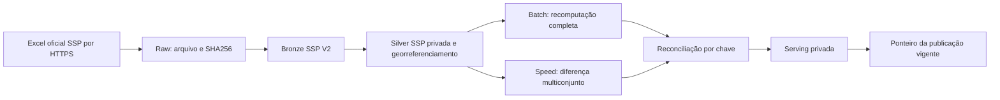

# Atlas Sampa

**Plataforma de inteligência territorial para explorar e comparar os 96 distritos administrativos da cidade de São Paulo.**

O **Atlas Sampa** transforma dados públicos de origens distintas em uma experiência de análise territorial. O produto permite que uma pessoa explore características de distritos, compare indicadores e ajuste o peso de critérios como mobilidade, serviços públicos, verde e lazer e ocorrências registradas. O objetivo é tornar diferenças territoriais compreensíveis, sem apresentar uma classificação universal de melhores e piores regiões.


**Estado da entrega em novembro de 2026:** Lakehouse com dados reais implementado; Gold distrital auditada; Star Schema Delta materializado; experimentos de classificação territorial concluídos; Consumer V2 materializado; MVP Streamlit V2 demonstrado em ambiente privado; arquitetura Lambda de atualizações da SSP implementada e reconciliada. Os dados de recomendação permanecem em **homologação privada**. O aplicativo não está autorizado para disponibilização pública e o agendamento mensal da Lambda permanece **PAUSED** por decisão operacional.

## 1. O problema que buscamos resolver

Escolher uma região para morar, investir ou estabelecer atividades depende de muito mais do que olhar um único número. A disponibilidade de transporte, a presença de serviços públicos, as condições urbanas, a dinâmica imobiliária e os registros de ocorrências criminais são dimensões diferentes. Cada uma nasce em uma fonte, com uma escala, uma granularidade territorial e um período de referência próprio.

Essa fragmentação impede comparações simples e também cria um risco: tratar um indicador isolado como se fosse uma resposta definitiva. Por isso, em vez de desenvolver um ranking fixo de bairros, construímos uma base distrital auditável e um aplicativo que apresenta os dados e permite personalizar critérios. A interface compara distritos administrativos oficiais, não bairros comerciais cujos limites variam conforme a fonte.

O desenho do produto combina três decisões. A primeira é usar os **96 distritos oficiais de São Paulo** como unidade comum, porque possuem códigos geográficos estáveis e uma malha territorial verificável. A segunda é manter os indicadores originais e suas ressalvas disponíveis na camada analítica, mesmo quando a interface utiliza índices padronizados para comparação. A terceira é separar **segmentação territorial** de **preferência do usuário**: os perfis identificam semelhanças estatísticas; os pesos escolhidos pela pessoa determinam a ordenação personalizada, sem transformar clusters em notas de qualidade.

## 2. Resultados técnicos e escopo validado

| Componente | Resultado ou situação |
|---|---|
| Recorte territorial | 96 distritos oficiais de São Paulo |
| Tabela analítica principal | `workspace.gold.distritos_wide` |
| Granularidade da Gold | 1 linha por distrito |
| Amplitude da Gold | 254 colunas, incluindo coordenadas |
| Coordenadas geográficas | 96 de 96 distritos |
| Modelagem dimensional | 4 dimensões e 3 fatos físicos em Delta Lake |
| Modelo exploratório de perfis | K-Means com 9 grupos, comparado com Ward |
| Consumer do MVP | `workspace.gold.bairroiq_frontend_v2`, 96 linhas e 20 campos |
| Interface | Streamlit V2 homologado em demonstração privada |
| Arquitetura Lambda SSP | Batch, Speed e Serving independentes da Gold oficial |
| Auditoria da Serving SSP | 250.606 ocorrências, 9 meses, 96 distritos e 2 categorias |
| Reconciliação SSP | 1.728 linhas Batch e 1.728 linhas Serving, com 0 divergências |
| Agendamento Lambda | Configurado para dia 10 às 10h, fuso de São Paulo, mas pausado |
| Integração e entrega | GitHub Actions e Databricks Asset Bundles com deploy controlado |
| Infraestrutura como código | Terraform versionado e validado por CI |

Esses números não se referem todos ao mesmo conjunto de dados. A **Gold oficial** é uma fotografia territorial construída a partir das fontes e períodos documentados na camada Silver. A **Serving da Lambda** é uma publicação privada e independente das versões do arquivo anual da SSP. Uma não atualiza a outra automaticamente. Preservar essa distinção impede que uma carga recém-processada altere silenciosamente os indicadores utilizados pelo aplicativo ou os perfis já calculados.

Os resultados acima documentam a execução e a auditoria realizadas. Eles não significam que todas as fontes estejam atualizadas na mesma data, nem que o produto tenha recebido autorização para recomendação residencial pública.

## 3. Arquitetura da solução

O projeto adota um **Lakehouse Medallion** para consolidar dados de diferentes formatos e um fluxo independente de **arquitetura Lambda** para demonstrar tratamento de republicações da SSP. Os dois desenhos coexistem porque resolvem problemas diferentes. Bronze, Silver e Gold organizam qualidade e transformação de dados; Batch, Speed e Serving tratam a recomputação e a reconciliação entre versões de uma fonte.

A implementação é composta por dois fluxos independentes. No **fluxo territorial principal**, os dados das fontes públicas atravessam Raw, Bronze e Silver até formar a Gold distrital, que sustenta a modelagem dimensional, os experimentos de Machine Learning e o Consumer V2 utilizado pelo Streamlit. No **fluxo privado da SSP**, novas versões da publicação anual são coletadas e tratadas em Bronze e Silver próprias; os caminhos Batch e Speed são reconciliados antes da publicação da Serving. Essa Serving não alimenta automaticamente a Gold oficial, porque a promoção de um novo recorte temporal exige validação dos indicadores, versionamento e revisão dos componentes dependentes.

O processamento utiliza **Databricks, Apache Spark e Delta Lake**. Spark foi escolhido para oferecer um motor comum a ingestão, transformações, validações distribuídas e consultas analíticas. Delta Lake fornece armazenamento transacional por tabela, evolução controlada de versões e a possibilidade de verificar conteúdos já materializados antes de reprocessar. O **Unity Catalog** centraliza namespaces, permissões e metadados, de modo que contratos e responsabilidades não fiquem escondidos dentro de notebooks isolados.

A arquitetura foi deliberadamente organizada em **produtos de dados com contratos explícitos**. A Gold conserva a amplitude analítica, o Star Schema oferece relações apropriadas para consultas OLAP e o Consumer V2 entrega um conjunto pequeno e estável de campos à interface. Essa separação facilita testar, versionar e explicar cada camada sem obrigar o frontend a reproduzir regras de transformação complexas.

### 3.1. Tecnologias e decisões

| Tecnologia | Papel e motivo da escolha |
|---|---|
| Python e SQL | Python concentra validação, ingestão e lógica geoespacial; SQL torna agregações e regras de dados inspecionáveis |
| PySpark | Processamento distribuído e contratos de escrita para Bronze, Silver e Gold |
| Delta Lake | Persistência versionável, reconciliação e reexecuções controladas |
| Unity Catalog | Organização de tabelas, metadados, permissões e linhagem quando disponível |
| GeoPandas e ferramentas geoespaciais | Associação de coordenadas à malha oficial, com verificação de CRS e geometrias |
| scikit-learn | Comparação reproduzível de métodos clássicos de agrupamento territorial |
| Databricks Asset Bundles | Definições versionadas de Jobs e promoção controlada de código |
| Terraform e HCP Terraform | Descrição declarativa de schemas e Volume Raw e validação de infraestrutura |
| GitHub Actions | Testes e validações antes de integrar e implantar mudanças |
| Streamlit e Plotly | MVP navegável, com filtros, mapas, critérios personalizados e gráficos comparativos |

A implementação foi concebida para aproveitar os recursos de desenvolvimento disponíveis e não depender de um serviço pago dedicado para cada função. Isso não significa que compute, SQL Warehouse ou Databricks Apps tenham custo zero em qualquer ambiente. Por esse motivo, o processamento é controlado, os snapshots são reutilizados quando idênticos e os agendamentos permanecem desativados até decisão explícita de operação.

## 4. Fontes, granularidade e integração territorial

| Fonte | Informação utilizada | Cuidado de interpretação |
|---|---|---|
| IBGE e malha distrital 2022 | População, domicílios, densidade, limites e identificação oficial | Distrito administrativo não é sinônimo de bairro de anúncio imobiliário |
| GeoSampa | Equipamentos e referências de infraestrutura urbana | Equipamento cadastrado não mede capacidade, frequência ou qualidade do serviço |
| ObservaSampa | Indicadores socioeconômicos e urbanos | Cada indicador possui período de referência próprio; empregos formais usados no modelo têm referência de 2021 |
| SSP-SP | Registros de roubos, furtos e outras ocorrências | Registros não equivalem a todos os eventos reais nem representam risco individual |
| Mercado imobiliário | Estoque e indicadores de anúncios | Cobertura territorial depende de correspondências aprovadas |
| OpenStreetMap | Referências de localização de bairros | É apoio geográfico à associação, não uma fonte oficial dos limites dos distritos |

O maior obstáculo de integração não era simplesmente reunir arquivos. As fontes utilizam **unidades territoriais diferentes**. Um nome de bairro presente em anúncios pode não coincidir com o nome de um distrito, e uma correspondência baseada somente em texto poderia atribuir imóveis ao lugar errado. Foi criado um processo de associação de localidades imobiliárias a distritos, com referências OSM, geração de candidatos, revisão e aprovação explícita.

Na última auditoria documentada dessa associação, existiam **1.626 localidades imobiliárias**, das quais **93 correspondências estavam aprovadas**. O estoque total considerado era de **70.706**, com **28.085 unidades de estoque associadas**, equivalentes a **39,72%**. A diferença não foi preenchida por suposições, porque números aparentemente completos com endereçamento incerto prejudicariam a confiabilidade do produto. Os indicadores imobiliários precisam ser lidos à luz dessa cobertura parcial; eles não são representativos de todo o município por construção.

O mesmo princípio foi aplicado às ocorrências da SSP. A associação espacial utiliza latitude, longitude, sistema de referência geográfica e o polígono distrital oficial. Registros sem associação válida são auditados, não atribuídos por aproximação arbitrária. A malha é validada para **96 códigos distritais distintos**. O cálculo dos centroides utiliza a projeção métrica **EPSG:31983** e publica coordenadas em **EPSG:4326**, evitando calcular o centro geométrico diretamente em graus geográficos.

## 5. Engenharia de dados: Raw, Bronze, Silver e Gold

### Raw e Bronze

A Raw preserva os arquivos de origem e os metadados de coleta. A Bronze representa o ponto de entrada estruturado para as transformações. A opção por preservar a versão recebida, em vez de sobrescrever o arquivo anterior, permite auditar mudanças feitas pela fonte pública e reproduzir um processamento com o mesmo conteúdo.

A ingestão não usa a data da execução como identidade do dado. Onde há versionamento de arquivos, o **SHA256 do conteúdo** identifica a publicação; onde há linha de origem, a aba e a posição são mantidas como identidade dentro daquela publicação. Isso reduz duplicações em reexecuções e evita tratar uma alteração da fonte como se fosse um dado totalmente novo sem histórico.

### Silver

A Silver implementa padronização, validação de tipos, tratamento de referências geográficas e consolidação da informação no grão adequado. A camada não preenche ausências com valores artificiais apenas para produzir um dataset sem nulos. Sempre que um indicador depende de cobertura parcial, denominador específico ou período de referência, essa condição é preservada no contrato e na documentação.

Os runners das fontes IBGE, GeoSampa, ObservaSampa, imóveis e SSP são separados porque cada fonte possui regras de extração e validação próprias. Essa separação facilita localizar problemas de qualidade e impede que uma mudança no layout de um fornecedor afete silenciosamente toda a cadeia de dados.

### Gold Wide

A tabela `workspace.gold.distritos_wide` consolida **96 registros e 254 atributos**. Foi adotado um modelo **Wide Table** porque o objetivo principal desta camada é consultar rapidamente um distrito e obter suas características lado a lado, inclusive como entrada para experimentos de Machine Learning. O código oficial `CD_DIST` garante uma linha por distrito, independentemente de diferenças de grafia nos nomes.

A Gold não cria uma data universal para os 254 atributos. Cada indicador utiliza a referência mais recente **disponível na fonte usada na construção do snapshot**, que pode ser diferente das demais. Não existe uma série temporal única nessa tabela. Incluir uma coluna de data de execução como se fosse a data de observação distorceria a interpretação de indicadores históricos. O histórico técnico de versões Delta não substitui o período estatístico de cada fonte.

A tabela possui documentação de campos, definições, unidades, limitações e regras de transformação no [dicionário de dados da Gold](docs/dicionario_gold_distritos_wide.md), além do [contrato estruturado em JSON](docs/dicionario_gold_distritos_wide.json). Também foram implementadas verificações de schema, cardinalidade, integridade, georreferenciamento e consistência da reconstrução a partir das fontes.

```sql
SELECT
    CD_DIST,
    NM_DIST,
    latitude,
    longitude,
    ibge_total_pessoas
FROM workspace.gold.distritos_wide
ORDER BY NM_DIST;
```

## 6. Modelagem dimensional: Star Schema

A Wide Table é apropriada para leitura rápida e para o treinamento dos modelos, mas não é a melhor forma de representar todas as relações analíticas. Por isso foi materializado um **modelo dimensional Delta**, com dimensões e fatos próprios, que permite consultar indicadores, perfis e prioridades por distrito sem repetir metadados descritivos em cada análise.

| Tabela Delta em `workspace.gold` | Grão ou responsabilidade | Registros no snapshot validado |
|---|---|---:|
| `bairroiq_dim_snapshot` | Versão, hash e disponibilidade do snapshot | 1 |
| `bairroiq_dim_distrito` | Distrito por snapshot | 96 |
| `bairroiq_dim_perfil` | Cadastro de perfis territoriais | 9 |
| `bairroiq_dim_indicador` | Metadados dos indicadores | 11 |
| `bairroiq_fato_distrito_indicador` | Distrito, indicador e snapshot | 1.056 |
| `bairroiq_fato_distrito_perfil` | Associação de distrito ao perfil | 96 |
| `bairroiq_fato_prioridade_ocorrencias` | Prioridade relativa de registros de crimes | 96 |
| **Total** | **4 dimensões e 3 fatos** | **1.365** |

A presença de `snapshot_id` nas chaves evita unir dados de versões diferentes como se fossem uma única fotografia. A dimensão de snapshot é registrada por último, após as validações das demais tabelas. Essa decisão protege o consumo contra uma execução parcialmente concluída, embora as sete escritas não sejam uma transação única entre tabelas.

Também evitamos criar uma dimensão calendário fictícia a partir da data da execução. Como a Gold agrega indicadores com períodos diferentes, uma `dim_data` única sugeriria uma temporalidade que os dados não possuem. Para análises de tendência, a referência adequada é uma Silver que preserve explicitamente o período original.

Uma consulta OLAP pode recuperar os indicadores por distrito e unidade sem confundir taxas com quantidades aditivas:

```sql
SELECT
    d.NM_DIST AS distrito,
    i.rotulo AS indicador,
    i.unidade,
    f.valor_numerico
FROM workspace.gold.bairroiq_fato_distrito_indicador f
JOIN workspace.gold.bairroiq_dim_distrito d
  ON f.snapshot_id = d.snapshot_id
 AND f.CD_DIST = d.CD_DIST
JOIN workspace.gold.bairroiq_dim_indicador i
  ON f.snapshot_id = i.snapshot_id
 AND f.indicador_sk = i.indicador_sk
ORDER BY distrito, indicador;
```

O modelo, as regras de escrita protegida e os controles de qualidade estão descritos no [contrato do Star Schema](docs/modelagem/star_schema_v1_delta_contrato.md).

## 7. Machine Learning: identificação de perfis territoriais

O problema de Machine Learning não foi tratado como previsão de onde alguém deve morar. A ausência de uma variável objetivo confiável para esse tipo de recomendação tornaria inadequado treinar um modelo supervisionado com rótulos inventados. Utilizamos **clusterização não supervisionada** para investigar padrões de similaridade entre os distritos e apresentar opções de exploração.

Comparamos **K-Means** e **agrupamento hierárquico Ward** sobre dados padronizados. Ambos dependem de distâncias e são sensíveis à escolha de variáveis e escala, portanto a comparação não foi reduzida a uma única métrica. Foram avaliados valores de `K` entre 2 e 12, tamanhos dos grupos, estabilidade sob subamostragem, distribuição territorial e capacidade de explicar os perfis a usuários não técnicos.

### 7.1. Por que K-Means e por que nove grupos

O objetivo inicial do produto era oferecer aproximadamente **dez perfis**, mas esse número é uma preferência de navegação, não uma propriedade comprovada dos dados. A análise com dez grupos gerou grupos muito pequenos, inclusive agrupamentos unitários. Manter `K=10` apenas para cumprir uma meta visual significaria oferecer tipos territoriais frágeis e difíceis de explicar.

A configuração candidata **K-Means com nove grupos** foi escolhida porque mantém tamanhos entre **6 e 22 distritos**, apresenta somente **três distritos com Silhouette individual negativa** e permite uma representação de perfis que pode ser consultada de forma repetível. O K-Means também oferece centroides no espaço de atributos e uma estratégia operacional simples para classificação futura, desde que o tratamento dos dados e a versão do modelo sejam preservados.

Isso **não significa que K-Means seja estatisticamente superior ao Ward em tudo**. No experimento comparável documentado, Ward com oito grupos apresentou Davies-Bouldin menor e estabilidade ARI maior. O tradeoff adotado privilegiou uma granularidade de produto próxima ao objetivo, a ausência de grupos minúsculos na opção selecionada e a facilidade de operacionalização. A separação global do K-Means K9 continua modesta e os perfis permanecem exploratórios.

| Métrica | Como interpretar | K-Means K9 | Ward K8 |
|---|---|---:|---:|
| Silhouette | Mede coesão e separação; maior é melhor, mas valores próximos de zero indicam sobreposição | 0,194467 | 0,193960 |
| Davies-Bouldin | Mede similaridade entre grupos segundo dispersão e separação; menor é melhor | 1,334164 | 1,202354 |
| Calinski-Harabasz | Compara dispersão entre e dentro dos grupos; maior é melhor para cenários comparáveis | 27,193823 | Não consolidado nesta tabela |
| ARI mediana de estabilidade | Concordância de partições em reamostragens; valores maiores indicam maior estabilidade | 0,470918 | 0,629504 |
| Menor grupo | Verifica a existência de segmentos pouco representados | 6 | 4 |
| Maior grupo | Mostra concentração da segmentação | 22 | 23 |

Os resultados acima correspondem às configurações registradas na metodologia, incluindo variações de tratamento de densidade. Não devem ser lidos como um experimento causal isolando apenas o algoritmo. O índice Silhouette também **não é acurácia**: não existe um conjunto de rótulos verdadeiros dos perfis territoriais para medir acertos ou erros.

A análise mais simples com poucos clusters chegou a produzir valores de Silhouette maiores, mas grupos amplos demais para representar a diversidade de experiências da interface. Da mesma forma, escolher dez ou onze agrupamentos somente para aumentar o número de opções comprometeria a interpretabilidade. Nove grupos foi um compromisso operacional explicitamente documentado, não a descoberta de nove categorias naturais definitivas.

### 7.2. Perfis territoriais candidatos

| Perfil | Nome mostrado ou proposto | Distritos |
|---|---|---:|
| P01 | Mais Praças, Vida Urbana | 9 |
| P02 | Praças em Regiões Menos Densas | 7 |
| P03 | Áreas Pouco Povoadas | 6 |
| P04 | Menos Roubos e Furtos | 22 |
| P05 | Transporte Coletivo em Destaque | 7 |
| P06 | Muitos Moradores por Km² | 8 |
| P07 | Empregos em Destaque | 12 |
| P08 | Mais Moradores, Menos Transporte | 19 |
| P09 | Escolas e UBS por Habitante | 6 |
| **Total** | | **96** |

Os títulos são rótulos de comunicação, sujeitos a ressalvas editoriais. O perfil P04 não assegura que todos os seus distritos apresentem taxas menores em todas as medidas; P07 reflete o indicador histórico de empregos formais e não a disponibilidade atual de vagas. Praças e corredores verdes cadastrados não equivalem a arborização de ruas, e equipamentos de transporte por habitante não indicam necessariamente menor tempo de viagem.

A estabilidade e as exceções são documentadas. Mooca, Socorro e Lajeado apresentaram Silhouette individual negativa na auditoria do catálogo K9, sinalizando fronteiras menos claras entre grupos. Eles não foram movidos manualmente para obter um resultado mais conveniente. Manter o output do algoritmo e explicar suas limitações foi preferível a ajustar classificações sem base reproduzível.

Os notebooks, contratos e resultados estão em [docs/ml](docs/ml/). A [metodologia do catálogo K9](docs/ml/metodologia_catalogo_perfis_v3.md) e a [comparação inicial K-Means versus Ward](docs/ml/metodologia_comparacao.md) registram as versões dos experimentos, os critérios e as limitações de cada abordagem.

## 8. Consumer V2 e aplicação Streamlit

O frontend não consulta diretamente 254 colunas nem precisa executar algoritmos de clusterização em cada interação. A Gold e o modelo dimensional alimentam o **Consumer V2**, uma tabela física destinada a disponibilizar os campos estritamente necessários para navegação e comparação:

`workspace.gold.bairroiq_frontend_v2`

Ela contém **96 distritos e 20 campos**, incluindo dados de consumo e metadados de auditoria. Essa escolha melhora a previsibilidade da interface, simplifica permissões e permite validar um contrato pequeno antes de abrir uma tela ao usuário. O Consumer V1 permanece como um artefato anterior versionado, mas **o MVP homologado utiliza o V2**.

Os quatro índices personalizados são `green_leisure_score`, `safety_score`, `mobility_score` e `public_services_score`, em escala de 0 a 100. Empregos formais, densidade populacional e taxa de roubos aparecem como informações complementares, sem serem incorporados aos quatro pesos da personalização. Essa separação evita que o aplicativo misture silenciosamente unidades físicas com percentis ou notas relativas.

A aplicação **Streamlit V2** tem cinco experiências principais:

1. **Personalizar cenário:** atribuir pesos aos quatro critérios de comparação.
2. **Explorar e visualizar:** exibir limites distritais, filtros e Top 10 calculado a partir do cenário.
3. **Comparar regiões:** selecionar distritos e analisar gráficos e indicadores lado a lado.
4. **Perfis urbanos:** conhecer o agrupamento exploratório associado a cada distrito.
5. **Fontes:** consultar a origem dos dados e as principais restrições metodológicas.

Os pesos são aplicados **na interface ao snapshot recebido**, não alteram a Gold, não reexecutam o K-Means e não modificam as propriedades dos distritos. O ranking resultante é uma ferramenta de exploração personalizada, não uma classificação oficial nem um parecer sobre segurança ou habitabilidade.

O mapa utiliza geometria distrital oficial disponibilizada em `streamlit/bairroiq-streamlit-v2/bairroiq/district_boundaries.geojson`. O app consulta o Databricks em modo somente leitura e valida campos, cardinalidade e consistência do snapshot antes de apresentar dados reais. Na homologação privada registrada em **8 de novembro de 2026**, foram testados mapa, ranking, filtros, comparação e perfis com o Consumer V2. A aplicação de homologação foi interrompida depois do teste.

**A demonstração privada não equivale à autorização para publicação pública.** O Consumer V2 mantém `publicacao_autorizada = false`. A configuração de prévia interna exige acesso restrito e opt-in explícito; o `app.yaml` versionado não habilita essa exceção por padrão. O aplicativo também oferece modo `sample` para testes com dados demonstrativos, sempre distinguindo esses dados dos 96 distritos reais.

O código, as instruções de execução local, a configuração do Databricks Apps e as evidências da demonstração estão no [README do Streamlit V2](streamlit/bairroiq-streamlit-v2/README.md).

## 9. Arquitetura Lambda para a SSP-SP

A SSP disponibiliza arquivos anuais que podem ser republicados com meses adicionais ou correções. Sobrescrever o arquivo anterior permitiria obter o valor mais recente, mas apagaria as evidências necessárias para explicar **o que mudou**. Para tratar esse problema construímos um fluxo separado, com versionamento da fonte, reprocessamento integral de referência, cálculo de diferenças e publicação reconciliada.

A arquitetura possui três componentes lógicos:

**Batch:** recompõe as contagens do snapshot da fonte por ano, mês estatístico, distrito e tipo de ocorrência. Para cada mês identificado, gera todas as combinações de 96 distritos e duas categorias, incluindo as combinações com zero ocorrências. Isso torna o resultado comparável entre versões, mesmo quando um distrito não possui registros em determinado grupo.

**Speed:** calcula a diferença entre duas publicações por multiplicidade de hashes de linhas. Um mesmo conteúdo pode aparecer mais de uma vez, e `NUM_BO` não foi assumido como chave globalmente única. Assim, o mecanismo identifica inclusões e exclusões sem descartar repetições legítimas, e trata alterações de conteúdo como retirada de uma versão e inclusão de outra.

**Serving:** recebe os números reconciliados, exigindo para cada chave a igualdade `Batch anterior + Speed = Batch atual`. Só depois da conferência é atualizado o apontador da versão publicada. Essa ordem diminui a chance de uma consulta recuperar um snapshot declarado como completo antes que seus dados tenham sido persistidos.



| Componente | Objeto físico |
|---|---|
| Bronze versionada | `workspace.bronze.ssp_ingestao_v2` |
| Staging exclusiva | `workspace.bronze.atlas_sampa_ssp_stage_v2` |
| Silver privada | `workspace.silver.atlas_sampa_ssp_v2` |
| Batch | `workspace.observability.atlas_sampa_ssp_batch_v1` |
| Speed | `workspace.observability.atlas_sampa_ssp_speed_v1` |
| Serving | `workspace.observability.atlas_sampa_ssp_serving_v1` |
| Controle da versão vigente | `workspace.observability.atlas_sampa_ssp_publication_v1` |

O processamento seleciona ocorrências de **furto, art. 155, e roubo, art. 157**, referentes ao município de São Paulo, e as associa espacialmente aos distritos. Registros sem localização distrital ficam disponíveis para auditoria privada, mas não são somados arbitrariamente às contagens por distrito.

### 9.1. Execução e resultado da homologação

A primeira execução real do Job `atlas-sampa-ssp-lambda` foi concluída no Databricks Serverless depois da correção de compatibilidade do script. Uma auditoria SQL sobre as tabelas publicadas confirmou:

| Indicador auditado | Resultado |
|---|---:|
| Ano de publicação | 2026 |
| Meses estatísticos presentes | 9 |
| Distritos com combinações publicadas | 96 |
| Tipos de ocorrência | 2 |
| Linhas Batch | 1.728 |
| Linhas Serving | 1.728 |
| Ocorrências em distritos na Serving | 250.606 |
| Divergências Batch versus Serving | 0 |
| Divergências Batch anterior + Speed versus Batch atual | 0 |
| Resultado da auditoria | `APROVADO` |

A auditoria atesta a consistência **da publicação testada**. Não prova que futuras republicações manterão exatamente o mesmo layout, nem que o mecanismo é um stream de eventos em tempo real. O caminho Speed aqui é uma **diferença incremental calculada entre arquivos completos**, processada em execuções pontuais. Essa forma foi escolhida por ser compatível com a maneira como a SSP publica seus dados e por permitir uma demonstração auditável sem manter um serviço contínuo de streaming.

O Job está definido em um **Databricks Bundle independente**, para que a evolução do módulo SSP não modifique inadvertidamente os Jobs existentes do projeto. A agenda foi configurada com cron mensal, dia 10 às 10h no fuso `America/Sao_Paulo`, mas permanece **PAUSED**. Não há atualização automática da Gold oficial nem do Consumer V2 a partir dessa Serving.

O módulo, seus testes e as regras de execução estão em [barrioiq_pipeline/atlas_sampa/ssp](barrioiq_pipeline/atlas_sampa/ssp/) e no documento [LAMBDA.md](barrioiq_pipeline/atlas_sampa/ssp/LAMBDA.md).

## 10. Governança, qualidade e observabilidade

A confiabilidade do projeto não depende apenas de executar transformações sem erro. Cada camada tem uma granularidade declarada e verificações próprias de cobertura, nulidade, duplicidade, formato, coordenadas e faixa de valores. Os testes interrompem o processamento quando encontram um contrato incompatível, em vez de converter silenciosamente um valor inesperado e produzir um resultado aparentemente válido.

O **versionamento Delta** e os **hashes SHA256** ajudam a identificar fotografias e mudanças de conteúdo. A documentação de colunas no Unity Catalog facilita a leitura dos indicadores por pessoas que não participaram da ingestão. Os contratos também distinguem valores absolutos, taxas por população, índices relativos e metadados técnicos. Essa distinção importa porque somar taxas como se fossem contagens, ou comparar um percentil diretamente com um número físico, comprometeria a análise.

A observabilidade está presente em diferentes níveis. Os scripts emitem mensagens e eventos estruturados, os Jobs guardam histórico de execução, o GitHub Actions registra verificações e o schema `workspace.observability` armazena saídas de auditoria e os componentes da Lambda. Há ainda workflows de coleta de indicadores operacionais e evidências de entrega. **Esses mecanismos não constituem monitoramento contínuo de produção**, e as métricas DORA de produção não são anunciadas como mensuradas quando não existe uma operação de produção instrumentada.

Na Lambda, a política de logs evita publicar identificadores de boletim de ocorrência, logradouros ou dados detalhados de registros. A aplicação web consome somente dados agregados por distrito, por uma identidade autorizada a ler o Consumer, sem credenciais pessoais fixadas no repositório. O bloqueio `publicacao_autorizada = false` é uma regra de produto e deve ser acompanhado das permissões reais do Unity Catalog, não tratado como substituto delas.

A governança reconhece que trabalhar com dados públicos não elimina riscos de interpretação. Índices de ocorrências não antecipam vitimização individual, perfis não garantem condições de moradia e indicadores históricos não devem ser apresentados como observações atuais.

## 11. CI/CD e infraestrutura como código

O repositório utiliza **GitHub Actions** para validar scripts, SQL, contratos, modelos e configurações antes da integração à `main`. O **Databricks Asset Bundle** permite manter as definições dos Jobs próximas ao código, reduzindo diferenças entre aquilo que foi revisado no GitHub e o que será executado no workspace.

A implantação do Bundle principal utiliza verificações antes de atualizar recursos existentes. O módulo Lambda possui **deploy manual próprio**, porque sua primeira publicação e as mudanças da SSP não devem ser disparadas pelo mesmo fluxo que distribui os demais componentes. O workflow manual de deploy não ativa o agendamento e não equivale a executar o processamento de dados.

O Terraform declara os schemas `bronze`, `silver`, `gold` e `observability`, além do Volume Raw gerenciado. A definição declarativa facilita inspecionar dependências e reaplicar configurações de forma disciplinada. A automação atualmente presente no repositório valida `terraform fmt`, `terraform init -backend=false` e `terraform validate`. **A passagem do CI confirma validade de configuração, não comprova sozinha que cada recurso foi provisionado por um `terraform apply`.** A evidência do estado de infraestrutura deve ser consultada no ambiente do HCP Terraform quando necessária.

As principais automações versionadas podem ser consultadas em [.github/workflows](.github/workflows/), e as declarações Terraform estão em [infra](infra/). O projeto não depende de publicações automáticas irrestritas para ser demonstrado; a separação entre CI, deploy e execução é uma medida deliberada de controle de custo e de risco sobre dados reais.

## 12. Como reproduzir e validar

Os testes offline verificam contratos e comportamento com dados sintéticos. Eles são rápidos e seguros para mudanças de código, mas não substituem a auditoria das tabelas reais no Databricks. A reprodução integral dos dados depende de acesso às fontes, Volumes, tabelas e permissões do ambiente utilizado.

### 12.1. Testes de engenharia, ML e contratos

```bash
git clone https://github.com/DCosso/bairroiq.git
cd bairroiq
python -m pip install -r barrioiq_pipeline/requirements-ml.txt
python -m unittest discover -s tests -p 'test_*.py' -v
```

Alguns testes especializados utilizam dependências adicionais, instaladas nos workflows correspondentes. Em caso de diferença de ambiente, os arquivos da pasta [.github/workflows](.github/workflows/) definem as dependências e versões usadas na verificação automatizada.

### 12.2. Aplicação em modo demonstrativo local

```powershell
cd streamlit/bairroiq-streamlit-v2
python -m pip install -r requirements-dev.txt
$env:BAIRROIQ_DATA_PROVIDER = 'sample'
python -m streamlit run app.py
```

O modo `sample` usa dados de demonstração, não substitui uma leitura homologada do Consumer V2 real. Para a experiência real, o [README do frontend](streamlit/bairroiq-streamlit-v2/README.md) documenta o Databricks Apps, o SQL Warehouse, as permissões necessárias e a regra de prévia restrita.

### 12.3. Conferência da Serving SSP

```sql
SELECT
    p.ano,
    COUNT(s.CD_DIST) AS linhas,
    COUNT(DISTINCT s.CD_DIST) AS distritos,
    COUNT(DISTINCT s.mes) AS meses,
    COUNT(DISTINCT s.tipo) AS tipos,
    SUM(s.quantidade) AS ocorrencias
FROM workspace.observability.atlas_sampa_ssp_publication_v1 p
JOIN workspace.observability.atlas_sampa_ssp_serving_v1 s
  ON s.source_sha256 = p.source_sha256
 AND s.ano = p.ano
GROUP BY p.ano
ORDER BY p.ano DESC;
```

A consulta lê a versão vigente apontada pelo controle de publicação, em vez de inferir a versão atual pelo maior hash ou pela última linha escrita. A reconciliação mais detalhada entre Batch, Speed e Serving consta das rotinas de homologação do módulo SSP.

## 13. Estrutura do repositório e documentação

```text
bairroiq/
|  README.md
|  .github/workflows/                  GitHub Actions e validações
|  infra/                              Terraform e configuração declarativa
|  EDA/                                Análise exploratória inicial
|  notebooks/                          Experimentos e exploração
|  barrioiq_pipeline/                  Runners, SQL, testes e Bundles
|     atlas_sampa/ssp/                 Coletor e arquitetura Lambda SSP
|     resources/                       Definições de Jobs principais
|     sql/                             Contratos e transformações SQL
|  docs/
|     arquitetura/                     Arquitetura e modelos lógicos
|     consumo/                         Auditoria e contrato dos consumidores
|     governanca/                      Regras semânticas e bloqueios
|     ml/                              Experimentos e métricas
|     modelagem/                       Modelo dimensional
|     dicionario_gold_distritos_wide.md
|     dicionario_gold_distritos_wide.json
|  streamlit/bairroiq-streamlit-v2/    Aplicação Atlas Sampa e testes
|  tests/                              Testes de engenharia e ML
```

Documentos de referência:

- [Dicionário de dados da Gold](docs/dicionario_gold_distritos_wide.md)
- [Contrato de dados da Gold em JSON](docs/dicionario_gold_distritos_wide.json)
- [Metodologia de Machine Learning e catálogo K9](docs/ml/metodologia_catalogo_perfis_v3.md)
- [Comparação inicial de K-Means e Ward](docs/ml/metodologia_comparacao.md)
- [Revisão semântica dos perfis](docs/governanca/encerramento_auditoria_semantica_v3.md)
- [Contrato do Star Schema Delta](docs/modelagem/star_schema_v1_delta_contrato.md)
- [Auditoria SQL do Consumer V2](docs/consumo/BairroIQ_Frontend_V2_Auditoria_Leitura.sql)
- [Frontend e homologação privada](streamlit/bairroiq-streamlit-v2/README.md)
- [Arquitetura Lambda SSP e controles](barrioiq_pipeline/atlas_sampa/ssp/LAMBDA.md)

## 14. Responsabilidades técnicas e colaboração

A execução do produto envolve competências complementares. **Engenharia de dados** estrutura a ingestão, transformação, versionamento e qualidade das fontes. **Analytics** define indicadores, unidades, interpretações e análises comparativas. **Ciência de dados** responde pela preparação das variáveis, experimentos, validação e interpretação dos clusters. **Desenvolvimento de produto e frontend** traduz esses resultados em interações, escolhas de critérios e visualizações compreensíveis. **DataOps e plataforma** mantêm testes, deploy, governança, custos e observabilidade.

A divisão por responsabilidades não significa que cada função pertença obrigatoriamente a uma pessoa exclusiva. Os contratos entre componentes permitem colaboração e revisão cruzada. Isso foi especialmente importante para garantir que as regras de negócio continuassem consistentes entre a Gold, a modelagem dimensional, o Consumer V2 e a experiência Streamlit.

## 15. Limitações e critérios de uso

O produto foi **validado como MVP privado de exploração territorial**. Não oferece avaliações imobiliárias individuais, previsão de criminalidade, estimativa de tempo de deslocamento, garantia de acesso a serviços ou recomendação residencial homologada. A publicação privada da SSP e a fotografia utilizada no aplicativo pertencem a ciclos distintos, e novos resultados de uma fonte não são promovidos automaticamente para a Gold nem para a interface.

Os nove perfis são hipóteses exploratórias de similaridade, sensíveis às variáveis, transformações e número de grupos escolhidos. A Silhouette relativamente baixa e a estabilidade moderada do K-Means K9 fazem parte do resultado científico, não são indicadores a esconder. Da mesma forma, a cobertura imobiliária de 39,72% e os períodos históricos de algumas fontes devem acompanhar qualquer interpretação dos dados.

O encerramento técnico da primeira publicação Lambda foi registrado com reconciliação aprovada e sem ativação do cron. A disponibilização pública do Consumer e do Streamlit exigiria uma aprovação específica de governança e controle de acesso, que **não foi concedida nesta entrega**.

O resultado é um sistema de dados reproduzível e demonstrável que mantém explícitas as escolhas metodológicas, os limites das fontes e o estado de autorização de cada componente.
